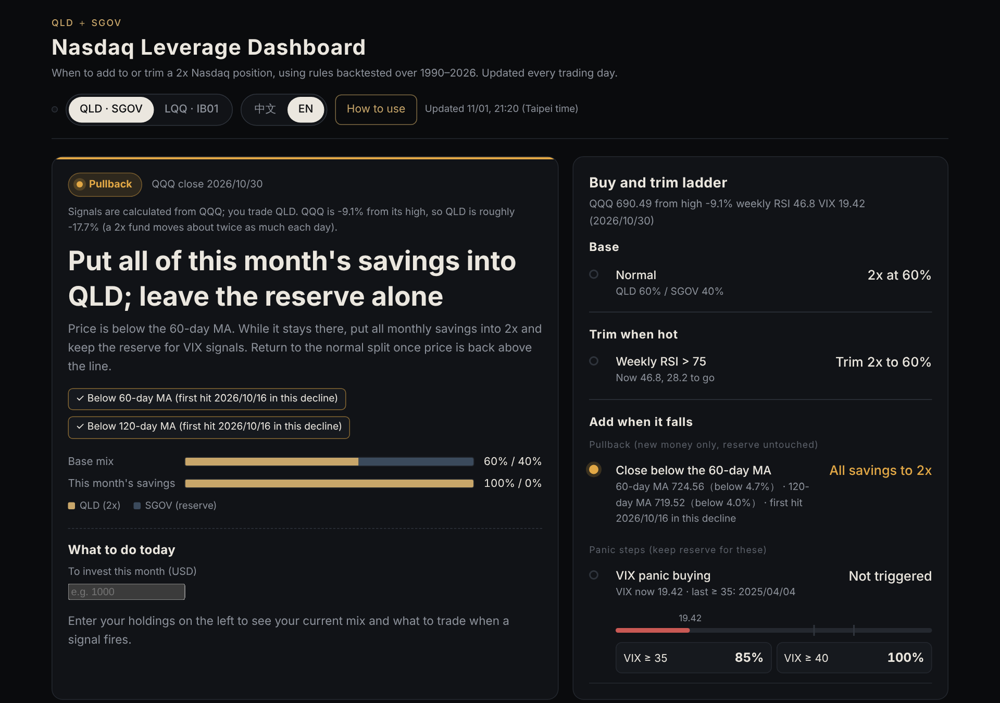

# Leverage Dashboard · 二倍槓桿加碼儀表板

**[English](#english) · [中文](#中文)**

**👉 https://salmonmisosoup.github.io/leverage-dashboard/home/**

---

## English

A free dashboard that tells you, every trading day, when to move between a 2x leveraged ETF, a plain 1x ETF and a cash-like reserve, using rules backtested over 1990–2026. Enter your holdings and it works out exactly what to buy or sell.

> ⚠️ This is a rules-based signal from historical backtests, not investment advice. Leveraged ETFs can lose most of their value in a long bear market (backtested maximum drawdown around −81%). Decide based on your own finances and risk tolerance.

### Two versions

| Version | Link | For |
|---|---|---|
| **Nasdaq** | https://salmonmisosoup.github.io/leverage-dashboard/us/ | US investors (QLD / QQQM / SGOV) or European investors (LQQ / EQQQ / IB01). English and Chinese. |
| **Taiwan + US** | https://salmonmisosoup.github.io/leverage-dashboard/ | Investors using a Taiwan broker: Taiwan 00685L / 0050 / 00713 and US 00670L / 00662 / 00865B. Chinese only. |

### Rules

The same rules for Taiwan and the US. Each day they are checked in this order; the first one that applies wins.

| | Rule |
|---|---|
| Base mix | 2x 60% / reserve 40% |
| Panic buy | VIX ≥ 35 → 2x at 85% (paused if the US 2-year yield rose > 0.5 pt or the BAA credit spread widened > 0.7 pt in 3 months); VIX ≥ 40 → 100%. Sell 1x first, then use reserve. If the credit spread widens > 0.8 pt in 3 months, all panic buying pauses for up to 30 trading days |
| Deep-drop top-up | VIX reached 35 within a year, price > 30% below its 1-year high, credit spread widened < 0.5 pt in 3 months → 2x at 100% |
| Taiwan sell-off (Taiwan only) | TAIEX down ≥ 10% over 20 days, the US credit spread widened < 0.3 pt in 3 months (not a credit crisis), and Taiwan VIX closes ≥ 40 (buy next day) or trades ≥ 45 intraday (buy right away) → 2x at 100%. Intraday ≥ 40 sends a heads-up email |
| Back to 2x | Margin signal off for 315 trading days (about 15 months) and price above the 60-day MA → all 1x back into 2x |
| Trim | Weekly RSI > 75 (US) / 80 (Taiwan) → 2x back to 60%, the rest into reserve |
| Margin overheating | US: FINRA margin debt > 50% YoY. Taiwan: TW margin balance ÷ index up > 20% in a year (margin growing faster than prices) and margin > 20% over 2 years, or the US signal → all 2x into 1x (QQQM / 0050). Not while VIX ≥ 35, in a deep drop, or within 60 trading days of a panic buy |
| Monthly savings | Price below the 60-day MA: all into 2x; otherwise 60 / 40. While margin is overheated the 2x share buys 1x |

Backtest (single investment): US 26.8% a year since 1990 (max drawdown −81%) vs 14.9% for holding QQQ; Taiwan 29.3% a year since 1999 (−65%) vs 11.9% for 0050. The full backtest chart is on the **Backtest** tab of each page.

Design notes, backtest comparisons and the main risks are under **How to use** on each page.

### Features

- Signals update every trading day; intraday VIX updates hourly during US market hours, and Taiwan VIX every 20 minutes during Taiwan market hours.
- **Your holdings**: type a ticker and share count, and the price fills in automatically. The page shows your current mix and the exact trades for today's signal, including how to split this month's savings. With no holdings yet, it tells you how to build the starting mix.
  - Taiwan: every TWSE / TPEx stock and ETF
  - US: any ticker
  - Europe: about 15,000 stocks and ETFs across European exchanges, by ticker or ISIN. If a ticker matches several securities (e.g. SAN = Santander or Sanofi), the page asks you to add the exchange suffix.
- Holdings are saved only in your own browser and never uploaded.
- Email alerts when a signal changes (when you run your own copy).

### Run your own copy

1. Fork this repository.
2. **GitHub Pages**: Settings → Pages → Source: *Deploy from a branch*, branch `main`, folder `/docs`.
3. **Actions write access**: Settings → Actions → General → Workflow permissions: *Read and write permissions*.
4. **FinMind token** (recommended): Settings → Secrets and variables → Actions → New repository secret, named `FINMIND_TOKEN`.
5. **Alerts** (optional):
   - By default, a GitHub Issue is opened when a signal changes, and GitHub emails your account.
   - Gmail directly: add secrets `MAIL_USERNAME`, `MAIL_PASSWORD` (a Gmail app password, not your login password) and `MAIL_TO`.
   - WhatsApp via CallMeBot: add secrets `WA_PHONE` and `WA_APIKEY`.

Secrets are encrypted and stay hidden even in a public repository. Never put tokens or passwords in code or pages.

### Schedules

| Workflow | When | What |
|---|---|---|
| `update.yml` | Weekdays 12:50 UTC, plus hourly during US market hours | `scripts/build_data.py`: fetches CBOE, FRED, FinMind, TWSE / TPEx and Yahoo data, computes the signals, updates `docs/data.json`, `docs/us/data.json` and `docs/prices.json` |
| `eu.yml` | Weekdays 17:10 UTC, after the European close | `scripts/build_eu.py`: updates European prices (`docs/us/eu.json`) and US ticker names (`docs/us/usn.json`) |

### Data sources

CBOE (VIX), FRED (credit spreads, Treasury yields), FINRA (US margin debt), TAIFEX (Taiwan VIX), FinMind (Taiwan and US prices), Taiwan Stock Exchange, Taipei Exchange, Yahoo Finance (European prices, FX). The ticker list comes from [FinanceDatabase](https://github.com/JerBouma/FinanceDatabase) (MIT).

### Feedback

Questions and ideas are welcome in [Discussions](https://github.com/salmonmisosoup/leverage-dashboard/discussions). Please report bugs in [Issues](https://github.com/salmonmisosoup/leverage-dashboard/issues).

### License

MIT

---

## 中文

用回測過的規則，每個交易日告訴你什麼時候在二倍槓桿、一倍原型和子彈之間移動：恐慌時加碼、過熱時調節、融資過熱時換成一倍原型。輸入自己的持股，還會直接算出要買賣哪幾檔、幾股。

> ⚠️ 這是依 1990–2026 年歷史回測整理的規則提示，不是投資建議。槓桿 ETF 在長期熊市中可能大幅虧損（回測最大回檔約 −81%），請依自身資金與風險承受度決定。

### 兩個版本

| 版本 | 網址 | 適合 |
|---|---|---|
| **納指版** | https://salmonmisosoup.github.io/leverage-dashboard/us/ | 美股（QLD／QQQM／SGOV）或歐洲券商（LQQ／EQQQ／IB01），中英切換 |
| **雙市場版** | https://salmonmisosoup.github.io/leverage-dashboard/ | 用台灣券商：台股 00685L／0050／00713，美股 00670L／00662／00865B，中文 |

### 規則摘要

台股、美股用同一套規則，每天依序檢查，前面成立就不看後面。

| | 規則 |
|---|---|
| 基準 | 二倍槓桿 60%／子彈 40% |
| 恐慌加碼 | VIX ≥ 35 → 二倍槓桿 85%（美國 2 年期殖利率 3 個月升超過 0.5 個百分點、或 BAA 利差擴大超過 0.7 時暫停）；VIX ≥ 40 → 100%。先賣一倍原型，不夠再用子彈。利差 3 個月擴大超過 0.8 時，所有恐慌加碼暫停，最多 30 個交易日 |
| 深跌補滿 | 一年內 VIX 曾 ≥ 35、距一年高點跌超過 30%、利差 3 個月擴大不到 0.5 → 二倍槓桿 100% |
| 台股急跌（只用在台股）| 近 20 日跌 ≥ 10%、美國信用利差 3 個月擴大不到 0.3（不是信用危機），而且台指 VIX 收盤 ≥ 40（隔天加碼）或盤中 ≥ 45（當下立即加碼）→ 二倍槓桿 100%。盤中 ≥ 40 先寄注意通知 |
| 融資退燒換回 | 融資訊號關閉滿 315 個交易日（約 15 個月）且收盤在季線上方 → 一倍原型全部換回二倍槓桿 |
| 過熱調節 | 週 RSI > 75（美股）／80（台股）→ 二倍槓桿調回 60%，賣出的錢買子彈 |
| 融資過熱 | 美股：FINRA 融資年增 > 50%。台股：融資餘額÷加權指數一年增加 > 20%（融資增加得比股價快）且融資兩年增長 > 20%，或美股訊號成立 → 二倍槓桿全部換成一倍原型（QQQM／0050）。VIX ≥ 35、深跌區、恐慌加碼後 60 個交易日內先不換 |
| 每月薪資 | 收盤在季線下方：全部買二倍槓桿；否則 60／40。融資過熱時，二倍槓桿那一份改買一倍原型 |

回測（一次投入）：美股 1990 年起年化 26.8%（最大跌幅 −81%），一直持有 QQQ 是 14.9%；台股 1999 年起年化 29.3%（−65%），0050 是 11.9%。完整回測圖在各頁的「回測」分頁。

設計理由、回測對照與最大風險，請看各頁面上的「使用說明」。

### 功能

- 每個交易日自動更新燈號，美股盤中每小時更新 VIX，台股盤中每 20 分鐘更新台指 VIX。
- **你的持股**：輸入代號和股數，價格自動帶入，算出目前比例、今天燈號要買賣多少，以及這個月的錢怎麼分。還沒有持股的話，會告訴你第一次怎麼建立組合。
  - 台股：所有上市、上櫃股票和 ETF
  - 美股：任何代號
  - 歐股：歐洲各交易所約 15,000 檔股票和 ETF，可輸入代號或 ISIN。同一個代號對到好幾檔時（例如 SAN 可能是 Santander 或 Sanofi），會提示你加上交易所代碼。
- 持股只存在你自己的瀏覽器，不會上傳。
- 燈號改變時寄 Email 通知（自己架設時可開啟）。

### 自己架一份

1. Fork 這個 repo。
2. **GitHub Pages**：Settings → Pages → Source 選 *Deploy from a branch*，Branch `main`、資料夾 `/docs`。
3. **Actions 寫入權限**：Settings → Actions → General → Workflow permissions 選 *Read and write permissions*。
4. **FinMind token**（建議）：Settings → Secrets and variables → Actions → New repository secret，名稱 `FINMIND_TOKEN`。
5. **通知**（選用）：
   - 預設燈號改變時會開 GitHub Issue，GitHub 會寄信到你帳號的信箱。
   - Gmail 直接寄：新增 Secrets `MAIL_USERNAME`、`MAIL_PASSWORD`（Gmail 應用程式密碼，不是登入密碼）、`MAIL_TO`。
   - WhatsApp（CallMeBot）：新增 Secrets `WA_PHONE`、`WA_APIKEY`。

Secrets 加密保存，公開 repo 也看不到。請不要把 token、密碼寫進程式碼或網頁。

### 自動更新

| Workflow | 時間 | 做什麼 |
|---|---|---|
| `update.yml` | 台北時間週一到週五 20:50，加上美股盤中每小時 | `scripts/build_data.py`：抓 CBOE、FRED、FinMind、證交所／櫃買中心、Yahoo 的資料，計算燈號，更新 `docs/data.json`、`docs/us/data.json`、`docs/prices.json` |
| `eu.yml` | 歐洲收盤後（UTC 17:10）| `scripts/build_eu.py`：更新歐股價格 `docs/us/eu.json` 和美股名稱 `docs/us/usn.json` |

### 資料來源

CBOE（VIX）、FRED（利差、殖利率）、FINRA（美股融資）、臺灣期貨交易所（台指 VIX）、FinMind（台股、美股價格、台股融資）、臺灣證券交易所、櫃買中心、Yahoo Finance（歐股價格、匯率）。代號清單來自 [FinanceDatabase](https://github.com/JerBouma/FinanceDatabase)（MIT 授權）。

### 意見回饋

有問題或想法，歡迎到 [Discussions](https://github.com/salmonmisosoup/leverage-dashboard/discussions) 留言；發現錯誤請開 [Issue](https://github.com/salmonmisosoup/leverage-dashboard/issues)。

### 授權

MIT
